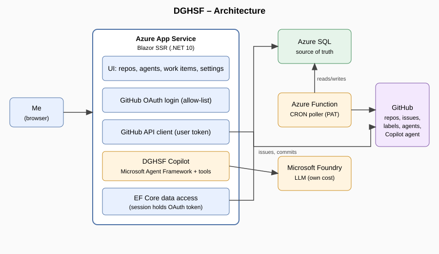
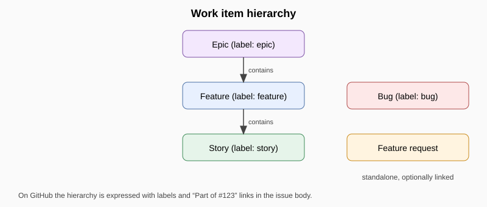
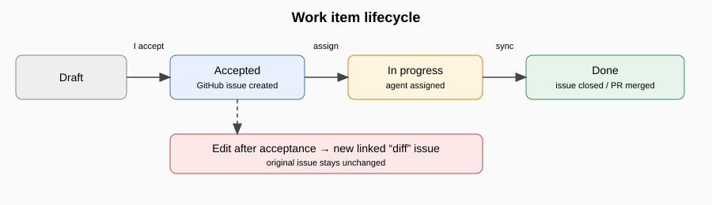
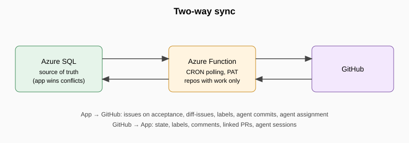

  

# DGHSF – Djohnnie's GitHub Software Factory

> Living idea document. It captures what I want to build before any implementation starts.

## 1. Vision

DGHSF is a personal, custom **software factory** web application. It lets me browse my GitHub repositories, manage custom Copilot agents per repository, plan work as epics, features, stories, bugs and feature requests, turn accepted items into GitHub issues, and hand those issues to GitHub's cloud agent. A built-in assistant, **DGHSF Copilot**, helps me write and maintain the planning items.

The application is for me only. My own database is the source of truth; GitHub is where accepted work gets executed.

## 2. Technology and hosting

- **.NET 10** with **Blazor Server-side rendering (SSR)**.
- **Entity Framework** on an **Azure SQL** database.
- Hosted eventually on an **Azure App Service**; local development comes first.
- A separate **Azure Function app** (CRON-triggered) handles synchronisation with GitHub.
- **DGHSF Copilot** is built with the **Microsoft Agent Framework** and connected to my own **Microsoft Foundry** (I pay for it). The model choice is made later.

## 3. Authentication and security

- Login is done with my **GitHub account** through a **GitHub OAuth App**, so the same user token can call the GitHub API.
- Only my GitHub account is allowed in: any other account is rejected (allow-list on GitHub user id/login).
- The OAuth token lives only in the **server-side session**. When it is lost or expires, I simply log in again.
- The Azure Function has no user session, so it uses a **fine-grained personal access token (PAT)**. The PAT is configured through a **settings page in the app** and stored in the database (encrypted at rest and never shown in full after saving).

## 4. Features

### 4.1 Repository browser

- Lists **all** my repositories (personal and organisation).
- Whenever I have to pick a repository, the list is sorted by most recent activity, using `pushed_at` from the GitHub repository list.
- Repository and label data are **cached in the database** for speed and to limit API calls.
- The repository page is the entry point for agents and work items.

### 4.2 Custom agent management

For each repository I can create, update and delete custom agents (the `.github/agents/*.agent.md` files). Changes are **committed directly** to the repository, with no pull request and no extra safeguards for now. Only repository-level agents are in scope; organisation-level agents may come later.

**Implemented (agent templates):** a **Templates** page (`/agent-templates`) stores agent templates in our own database, and doesn't need a repository to be selected. A template holds the full agent file (frontmatter + instructions). From a template I can create an agent in the current repository (the editor is prefilled), or **add it to several repositories at once**: I can optionally replace files that differ, and identical files are left untouched. On the Agents page, **Save as template** turns an existing agent into a template.
### 4.3 Work items

I plan work in the app using five item types:

- **Epic**, **Feature** and **Story** form a hierarchy: an epic contains features, and a feature contains stories.
- **Bug** and **Feature request** are standalone items that can optionally be linked.

Items live in the app's database as drafts. Nothing reaches GitHub until I **manually accept** an item. On acceptance the item becomes a GitHub issue.

**Implemented (epics):** an **Epics** page (`/epics`) per selected repository with full CRUD (title, Markdown description, assignment settings). **Accept & assign** creates a GitHub issue labelled `epic` (the label is created when missing; the body ends with a hidden `<!-- dghsf:epic:{id} -->` marker), then assigns it to the Copilot cloud agent. Once accepted, the title and description are read-only; deleting an epic only removes it from the app, never the issue. Features, stories, bugs and feature requests come later.

### 4.4 Labels and issue mapping

- The type of an item is expressed with **labels only** (for example `epic`, `feature`, `story`, `bug`, `feature-request`). I do not use GitHub issue types, sub-issues or a Projects board.
- The hierarchy is kept in the app, and written into the issue body as links such as "Part of #123" or task lists.
- I can fetch the labels of a repository and **create, update and delete** them from the app.
- When creating an issue I can choose labels manually, or have them assigned automatically. I want to explore a mix of **rules** (item type to label) and **AI suggestions** from DGHSF Copilot.

### 4.5 Lifecycle and changes after acceptance

An item moves from **Draft** to **Accepted** (issue created), then **In progress** (agent assigned), and finally **Done** (issue closed and/or pull request merged).

Accepted items are not edited in place on GitHub. If I change an accepted item, the app automatically creates a **linked "diff" issue** that summarises what changed and links back to the original issue. The original issue stays as it was.

### 4.6 Agent assignment

I can assign GitHub's **Copilot cloud agent** to an issue, choosing:

- a **custom agent** from the repository's `.github/agents`, and
- the **model** for that specific assignment.

The app shows the agent's session status and links to the resulting pull request, and lets me **re-assign or unassign** the agent.

**Verified and implemented:** the REST API supports this (public preview): `POST /repos/{owner}/{repo}/issues/{number}/assignees` with assignee `copilot-swe-agent[bot]` and an `agent_assignment` object (`target_repo`, `base_branch`, `custom_instructions`, `custom_agent`, `model`). The custom agent id is the agent file name without `.agent.md`. An epic stores the agent, model (from the managed models list; empty means auto), base branch and custom instructions. On accept, the status goes to **In progress** when GitHub confirms Copilot is assigned. If the assignment fails (for example when the cloud agent isn't enabled for the repository), the epic stays **Accepted** with its issue, and **Assign agent** retries. Session status, PR links and unassign are still to do.

### 4.7 Two-way synchronisation

An Azure Function polls GitHub on a CRON schedule (no webhooks), and only for repositories that have actual work in the app. Everything flows back into the app: issue state, labels, comments, linked pull requests and agent sessions. When both sides changed, **the app wins**.

### 4.8 DGHSF Copilot

My own assistant, backed by Microsoft Foundry and the Microsoft Agent Framework, with tools to interact with the application. It works in two modes:

- **In-page assist:** on a CRUD page (for example creating an epic) it fills in or changes the form in the UI. I always decide whether to save.
- **Chat mode:** outside a specific page, it can act directly through tools without UI, such as updating epics, features and stories. **Destructive actions** (deleting, accepting or creating issues) need my confirmation.

Conversations are **persisted** as chat history.

**Implemented (in-page assist):** a generic agent (`AssistantAgentFactory`, Microsoft Agent Framework `ChatClientAgent`) uses an OpenAI-compatible endpoint configured with `OpenAI:Endpoint` (empty = public OpenAI; Foundry/Azure OpenAI resource-root URLs automatically use `/openai/v1/`, while explicit API paths are preserved), `OpenAI:Model` (the deployment name on Azure) and `OpenAI:ApiKey`. It uses the Responses API to support reasoning with function tools; set `OpenAI:UseResponsesApi` to `false` for services that only support Chat Completions. The agent editor and the draft epic editor have a chat panel. The assistant asks follow-up questions and prefills the form through tools; I still save manually. Chat history isn't persisted yet, and chat mode is still to do.

## 5. Models and cost

I want to list the available models and their cost. What I found:

- The **GitHub Models** catalog is **retired** (fully since July 30, 2026), so it cannot be used.
- I haven't found a stable public API that lists Copilot models with their cost multipliers.
- Still to investigate: whether the Copilot SDK/CLI exposes a model list. (The cloud agent assignment does accept a model; see 4.6.)

**Implemented:** a **Models** page (`/models`) keeps a managed list of models in our own database (EF Core, SQL Server / LocalDB in development). Models are shared across repositories.

- Full CRUD: name, model id (the value written to an agent's `model` key), provider, release status, category, tier/threshold, and USD prices per 1M tokens (input, cached input, cache write, output). Models can be enabled or disabled.
- **Import from GitHub docs**: paste the link to the Copilot "Models and pricing" page (only `https://docs.github.com/...` is allowed). The pricing tables are scraped and shown as a preview (new / price change / unchanged), and the selected rows are imported. Existing models are matched on name + tier; their prices are refreshed, but a changed model id or enabled state is kept. The model id is derived from the name (e.g. "Claude Sonnet 4.6" → `claude-sonnet-4.6`) and can be edited.
- The **agent editor** offers the enabled models in a dropdown that shows the name, provider and input/output cost, plus the long-context pricing. A `model` value that isn't in the list stays visible and is kept.

## 6. Roadmap (MVP order)

1. Login (GitHub OAuth, single-user allow-list) and repository list.
2. Settings page (PAT) and custom agent management per repository.
3. Work items (epics, features, stories, bugs, feature requests) and label management.
4. Accept → GitHub issue creation, including diff-issues.
5. Agent assignment (custom agent and model) and run tracking.
6. Azure Function polling and two-way sync.
7. DGHSF Copilot: in-page assist first, then chat mode with tools.

## 7. Open points

- Exact **PAT permissions** (contents, issues, pull requests, metadata) and a rotation plan.
- ~~Verify that the **assignment API** supports a custom agent and model per assignment.~~ Verified (public preview); see 4.6.
- The model list is scraped from the docs page; check that the derived **model ids** match what Copilot accepts.
- Decide which **Foundry model** to use.
- Decide how **auto-labelling** combines rules and AI suggestions.
