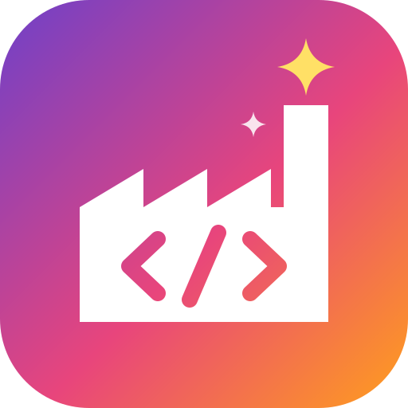

<p align="center">
  
</p>

# DjohnnieGitHubSoftwareFactory

DGHSF is a personal software factory for GitHub: a single-user web app to plan work and hand it to the GitHub Copilot cloud agent.

- **Plan work items** per repository: epics, features, user stories, bugs and tasks, with templates per type.
- **Accept** an item to create a labelled GitHub issue, linked to its parent and children as sub-issues. Stories, bugs and tasks are then assigned to the Copilot cloud agent, optionally with a custom agent, model, base branch and extra instructions.
- **Or run the agent yourself**: an item that runs on the DGHSF agent worker is implemented by a container job with the GitHub Copilot SDK. The job clones the repository, lets the agent work on a new branch, opens the pull request, and records the AI credits and tokens of every run. Feedback sent from the pull request's discussion in DGHSF first refreshes the item and every item above it from their GitHub issues (nothing is posted when that fails), then starts a revision run: it merges the latest base branch into the pull request's branch, addresses every comment written since the agent's last run (also those written on GitHub), pushes to the same branch and answers each comment. Starting another run by hand after a failed one (Revise, or Start over with a new pull request) refreshes them the same way first. When a revision pushed changes, it then asks Copilot code review to review the pull request again; for feedback sent to the Copilot cloud agent, the sync function does that once Copilot's agent session for the feedback has succeeded.
- **Manage custom agents** (`.github/agents/*.agent.md`) and the repository's `.github/copilot-instructions.md`, and share agent templates across repositories.
- **DGHSF Agent** chats on every editor (including the Copilot Skills Agent on the skill editor) help fill in the form. Background agents suggest a model per item and write suggestion chips. Their prompts are editable on the internal agents page.
- **Chat** about the whole project: the DGHSF Agent on `/chat` answers questions about the selected repository from everything DGHSF stores about it, the repository's files and (with the GitHub MCP server) its GitHub activity. Conversations are kept per repository in a history list and named in two words; every 10 messages a summary replaces the older messages in what the agent gets, while the chat keeps showing them all.
- **Generate work items from a repository**: background agents read the code and write fully described epics, features, user stories and (for improvements) bugs as drafts. A run either proposes improvements or describes what already exists. It runs as background tasks in the Tasks function app, and its progress shows on the Background tasks page.
- **Generate work items from a mindmap**: the Mindmap Planner turns the central idea into an epic and the other ideas into its features and their user stories, so the plan always ends in user stories. You review the proposals and pick which ones to save as drafts, and each saved item is linked to its ideas.
- **Manage the AI models** Copilot can use, including importing GitHub's model pricing.
- **Track token spend** of the internal agents: a catalog of Microsoft Foundry models with their prices, a cost per request, and a running cost per agent that later price changes don't affect.

See [`IDEAS.md`](IDEAS.md) for the vision and roadmap. It mixes implemented and planned features.

## Tech stack

.NET 11 Blazor (Interactive Server) with MudBlazor, EF Core on SQL Server, MediatR with FluentValidation, Microsoft Agent Framework on an OpenAI-compatible endpoint, GitHub OAuth, and Azure App Service with Azure SQL and Blob Storage.

| Project | Responsibility |
| --- | --- |
| `Djohnnie.SoftwareFactory.Web` | Blazor UI, GitHub sign-in, the selected repository |
| `Djohnnie.SoftwareFactory.Sync` | Azure Function that archives repositories removed from GitHub and refreshes accepted work items from GitHub on a CRON schedule |
| `Djohnnie.SoftwareFactory.Tasks` | Azure Function that runs the background tasks in SQL: a timer dispatcher queues them on Azure Service Bus, a queue-triggered executor runs them. It also queues the agent worker's runs |
| `Djohnnie.SoftwareFactory.Worker` | Console app for an event-driven Azure Container Apps job: takes one agent run from Service Bus and runs it with the GitHub Copilot SDK |
| `Djohnnie.SoftwareFactory.Application` | MediatR commands and queries per feature, validation, GitHub API client, workflows |
| `Djohnnie.SoftwareFactory.DataAccess.Sql` | EF Core entities, stores, migrations |
| `Djohnnie.SoftwareFactory.Agents` | DGHSF's internal agents and their form tools |
| `Djohnnie.SoftwareFactory.Contracts` | Records shared by all projects |

[`.github/copilot-instructions.md`](.github/copilot-instructions.md) describes the architecture, conventions and invariants; [`docs/features.md`](docs/features.md) describes how each feature works.

## Running it locally

Prerequisites:

- The .NET 11 SDK (version pinned in `global.json`).
- SQL Server. LocalDB works.
- A GitHub OAuth app with the callback URL `https://localhost:7254/signin-github`.

Create `src/Djohnnie.SoftwareFactory.Web/appsettings.Development.json`. It is gitignored, so it can hold secrets, or you can use `dotnet user-secrets`:

```json
{
  "ConnectionStrings": {
    "Database": "Server=(localdb)\\MSSQLLocalDB;Database=DGHSF;Trusted_Connection=True;TrustServerCertificate=True"
  },
  "GitHub": {
    "ClientId": "<OAuth app client id>",
    "ClientSecret": "<OAuth app client secret>",
    "AllowedUserId": <the numeric id of your GitHub account, from https://api.github.com/users/<your login>>
  },
  "OpenAI": {
    "Endpoint": "<empty for OpenAI, or an Azure OpenAI / Foundry resource URL>",
    "Model": "<model or deployment name>",
    "ApiKey": "<key>"
  },
  "ImageUploads": {
    "ConnectionString": "<optional: Azure Storage connection string for images in Markdown editors>"
  },
  "KnowledgeBase": {
    "ConnectionString": "<optional: Azure Storage connection string for knowledge base files, e.g. UseDevelopmentStorage=true for Azurite>"
  },
  "KnowledgeSearch": {
    "Endpoint": "<optional: Azure AI Search URL, e.g. https://my-search.search.windows.net, so the chat agents search the knowledge base>",
    "ApiKey": "<a query key of the search service>"
  },
  "Speech": {
    "Region": "<optional: Azure AI Speech region, e.g. westeurope, to dictate titles>",
    "ApiKey": "<Speech resource key>",
    "Language": "en-US"
  }
}
```

Then run:

```shell
dotnet run --project src/Djohnnie.SoftwareFactory.Web --launch-profile https
```

In Development, the app applies the EF Core migrations at startup to the database in `ConnectionStrings:Database`. Point it at a local database, not production. Without the `OpenAI` settings the app still works, but the Copilot chats show a setup hint. Without the `Speech` settings the microphone buttons next to the title fields are hidden.

Without the `KnowledgeBase` settings the knowledge base can't store files. When it can, keep in mind that **knowledge base files are public**: they are stored in a blob container with anonymous read access, so work items and GitHub issues can link to them. Anyone with a link can open the file, together with its title, description and folder path, which are stored as blob metadata. Don't upload confidential data, such as secrets, credentials, personal data or internal documents that may not be shared. The page and the upload dialog show the same warning.

A knowledge base file is either global (every repository sees it) or belongs to the repository that was selected when it was uploaded or edited. Folders belong to a repository and organize its files; global files are always at the top of the library, never in a folder. With the `KnowledgeSearch` settings, the work item chat agents can search the content of the global files and the selected repository's files (RAG with Azure AI Search). `docs/azure-deployment.md` explains how to set up the search service.

### The sync function

`Djohnnie.SoftwareFactory.Sync` needs [Azure Functions Core Tools](https://learn.microsoft.com/azure/azure-functions/functions-run-local) v4 and a storage emulator such as Azurite for its timer. Create `src/Djohnnie.SoftwareFactory.Sync/local.settings.json`, which is gitignored:

```json
{
  "IsEncrypted": false,
  "Values": {
    "AzureWebJobsStorage": "UseDevelopmentStorage=true",
    "FUNCTIONS_WORKER_RUNTIME": "dotnet-isolated",
    "WorkItemSyncSchedule": "0 */15 * * * *",
    "ConnectionStrings__Database": "Server=(localdb)\\MSSQLLocalDB;Database=DGHSF;Trusted_Connection=True;TrustServerCertificate=True",
    "GitHub__SyncToken": "<GitHub token that can read the issues, pull requests, checks and Actions runs of your repositories, and request reviewers on pull requests>"
  }
}
```

Then run `func start` in that directory. The function doesn't apply migrations, so run the web app once first.

Every run first checks that each repository in the database still exists on GitHub. One that GitHub answers 404 for is archived: it leaves the favorites and the recently accessed repositories, its work items are no longer synced, and the repository picker lists it separately under "Removed from GitHub". It can still be opened to view everything DGHSF stored, with everything that needs GitHub disabled. GitHub also answers 404 for a repository the token can't see, so give the sync token access to every repository DGHSF works with; an archived repository that GitHub knows again is restored by the next run (or by selecting it from GitHub's list in the picker).

After feedback was sent to the Copilot cloud agent from DGHSF, the sync watches Copilot's Actions runs on the pull request's branch. Once the first session that started after the feedback has succeeded, it asks Copilot code review to review the pull request; apart from asking agents to revise (see below) and to fix merge conflicts, that is the only thing the sync writes to GitHub. It stops waiting when the pull request is merged or closed, when Copilot's session fails, when Copilot hasn't started within 6 hours, or when GitHub refuses the request, and writes a warning to the sync log. For items with "Revise after Copilot code review" on, the sync also asks the agent to address Copilot code review's remarks by itself: the DGHSF agent worker gets a revision run, the Copilot cloud agent a comment mentioning `@copilot` that lists the remarks, for at most 3 rounds of remarks per pull request. The token's account needs Copilot code review for the request to succeed.

### The tasks function

`Djohnnie.SoftwareFactory.Tasks` runs the "Generate from repository" runs (and later other background work). The web app only stores background tasks in SQL. In the function app, a timer moves the tasks that are due to an Azure Service Bus queue, and a queue trigger executes them. It needs the same tools as the sync function, plus a Service Bus namespace with a queue (for example `todo-tasks`). Create `src/Djohnnie.SoftwareFactory.Tasks/local.settings.json`, which is gitignored:

```json
{
  "IsEncrypted": false,
  "Values": {
    "AzureWebJobsStorage": "UseDevelopmentStorage=true",
    "FUNCTIONS_WORKER_RUNTIME": "dotnet-isolated",
    "TodoTaskDispatchSchedule": "*/15 * * * * *",
    "TodoTaskQueueName": "todo-tasks",
    "ServiceBus": "<Service Bus connection string>",
    "ConnectionStrings__Database": "Server=(localdb)\\MSSQLLocalDB;Database=DGHSF;Trusted_Connection=True;TrustServerCertificate=True",
    "GitHub__TasksToken": "<GitHub token that can read the contents of the repositories you analyze>",
    "OpenAI__Endpoint": "<same as the web app>",
    "OpenAI__Model": "<same as the web app>",
    "OpenAI__ApiKey": "<same as the web app>",
    "RepositorySnapshots__ConnectionString": "UseDevelopmentStorage=true"
  }
}
```

Then run `func start --port 7072` in that directory, so it can run next to the sync function on port 7071.

`RepositorySnapshots__ConnectionString` is optional. With it, a run downloads the repository once as an archive into the private `repository-snapshots` blob container (Azurite locally), and all its tasks read their files from there. Without it, every task reads from the GitHub API.

### The agent worker

`Djohnnie.SoftwareFactory.Worker` runs one agent run per start and then exits; in Azure a Container Apps job starts it for every message on the `agent-runs` queue. It needs git on the `PATH` and a GitHub Copilot plan; the build downloads the Copilot runtime it starts. To try it locally, set `AgentRuns__QueueName` in the tasks function (so it queues the runs) and create `src/Djohnnie.SoftwareFactory.Worker/appsettings.Development.json`, which is gitignored:

```json
{
  "ConnectionStrings": {
    "Database": "Server=(localdb)\\MSSQLLocalDB;Database=DGHSF;Trusted_Connection=True;TrustServerCertificate=True"
  },
  "ServiceBus": "<Service Bus connection string>",
  "AgentRuns": {
    "QueueName": "agent-runs"
  },
  "AgentWorker": {
    "GitHubToken": "<fine-grained token: contents and pull requests read and write, issues read>",
    "CopilotToken": "<optional: fine-grained token with the Copilot Requests permission; defaults to GitHubToken>",
    "MaxAiCreditsPerRun": 500
  }
}
```

Then accept a story, bug or task with **Runs on** set to *DGHSF agent worker* and run `dotnet run --project src/Djohnnie.SoftwareFactory.Worker --environment Development` once it is queued. The agent may run any command on your machine, so prefer the container image (`src/Djohnnie.SoftwareFactory.Worker/Dockerfile`).

With **Include UI screenshots** on (the default), the agent starts the app it changed, takes screenshots of the screens it changed with Playwright and adds them to the pull request. That needs the `ImageUploads` settings of the web app in the worker's settings too, and Node.js with `playwright` and its Chromium on the machine (the container image has them).

## Tests

```shell
dotnet test tests/Djohnnie.SoftwareFactory.Web.Tests/Djohnnie.SoftwareFactory.Web.Tests.csproj
```

Most tests use bUnit and the EF Core InMemory provider. `SqlServerStoreTests` run against a real SQL Server, in a new database built by the migrations:

- On Windows they use LocalDB.
- Elsewhere, set `DGHSF_TEST_SQL_SERVER` to a connection string without a database. CI does this with a SQL Server container.
- They are skipped when no server is available.

## Deployment

Every push to `main` builds, tests, migrates Azure SQL and deploys to Azure App Service and Azure Functions, and (once it is set up) the agent worker's image to its Azure Container Apps job. See [`docs/azure-deployment.md`](docs/azure-deployment.md).
