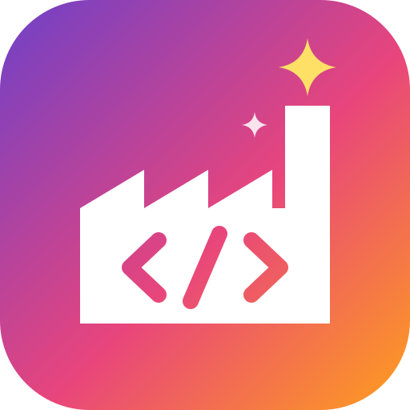

<p align="center">
  
</p>

# DjohnnieGitHubSoftwareFactory

DGHSF is a personal software factory for GitHub: a single-user web app to plan work and hand it to the GitHub Copilot cloud agent.

- **Plan work items** per repository: epics, features, user stories, bugs and tasks, with templates per type.
- **Accept** an item to create a labelled GitHub issue, linked to its parent and children as sub-issues. Stories, bugs and tasks are then assigned to the Copilot cloud agent, optionally with a custom agent, model, base branch and extra instructions.
- **Manage custom agents** (`.github/agents/*.agent.md`) and the repository's `.github/copilot-instructions.md`, and share agent templates across repositories.
- **DGHSF Copilot** chats on every editor help fill in the form. Background agents suggest a model per item and write suggestion chips. Their prompts are editable on the internal agents page.
- **Manage the AI models** Copilot can use, including importing GitHub's model pricing.

See [`IDEAS.md`](IDEAS.md) for the vision and roadmap. It mixes implemented and planned features.

## Tech stack

.NET 10 Blazor (Interactive Server) with MudBlazor, EF Core on SQL Server, MediatR with FluentValidation, Microsoft Agent Framework on an OpenAI-compatible endpoint, GitHub OAuth, and Azure App Service with Azure SQL and Blob Storage.

| Project | Responsibility |
| --- | --- |
| `Djohnnie.SoftwareFactory.Web` | Blazor UI, GitHub sign-in, the selected repository |
| `Djohnnie.SoftwareFactory.Application` | MediatR commands and queries per feature, validation, GitHub API client, workflows |
| `Djohnnie.SoftwareFactory.DataAccess.Sql` | EF Core entities, stores, migrations |
| `Djohnnie.SoftwareFactory.Agents` | DGHSF's internal agents and their form tools |
| `Djohnnie.SoftwareFactory.Contracts` | Records shared by all projects |

[`.github/copilot-instructions.md`](.github/copilot-instructions.md) describes the architecture and conventions in detail.

## Running it locally

Prerequisites:

- The .NET 10 SDK (version pinned in `global.json`).
- SQL Server. LocalDB works.
- A GitHub OAuth app with the callback URL `https://localhost:7254/signin-github`.

Create `src/Djohnnie.SoftwareFactory.Web/appsettings.Development.json`. It is gitignored, so it can hold secrets, or you can use `dotnet user-secrets`:

```json
{
  "ConnectionStrings": {
    "Database": "Server=(localdb)\\MSSQLLocalDB;Database=DGHSF;Trusted_Connection=True;TrustServerCertificate=True"
  },
  "GitHub": {
    "ClientId": "<OAuth app client id>",
    "ClientSecret": "<OAuth app client secret>",
    "AllowedLogin": "<your GitHub login>"
  },
  "OpenAI": {
    "Endpoint": "<empty for OpenAI, or an Azure OpenAI / Foundry resource URL>",
    "Model": "<model or deployment name>",
    "ApiKey": "<key>"
  },
  "ImageUploads": {
    "ConnectionString": "<optional: Azure Storage connection string for images in Markdown editors>"
  },
  "Speech": {
    "Region": "<optional: Azure AI Speech region, e.g. westeurope, to dictate titles>",
    "ApiKey": "<Speech resource key>",
    "Language": "en-US"
  }
}
```

Then run:

```shell
dotnet run --project src/Djohnnie.SoftwareFactory.Web --launch-profile https
```

In Development, the app applies the EF Core migrations at startup to the database in `ConnectionStrings:Database`. Point it at a local database, not production. Without the `OpenAI` settings the app still works, but the Copilot chats show a setup hint. Without the `Speech` settings the microphone buttons next to the title fields are hidden.

## Tests

```shell
dotnet test tests/Djohnnie.SoftwareFactory.Web.Tests/Djohnnie.SoftwareFactory.Web.Tests.csproj
```

Most tests use bUnit and the EF Core InMemory provider. `SqlServerStoreTests` run against a real SQL Server, in a new database built by the migrations:

- On Windows they use LocalDB.
- Elsewhere, set `DGHSF_TEST_SQL_SERVER` to a connection string without a database. CI does this with a SQL Server container.
- They are skipped when no server is available.

## Deployment

Every push to `main` builds, tests, migrates Azure SQL and deploys to Azure App Service. See [`docs/azure-deployment.md`](docs/azure-deployment.md).
